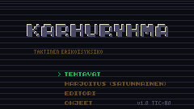
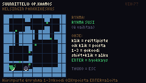
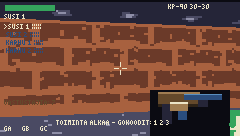
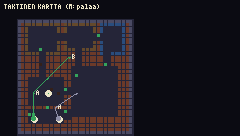
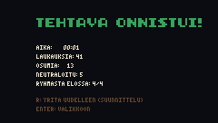
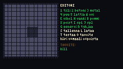
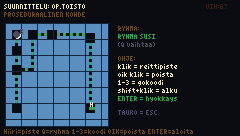

# KARHURYHMÄ — taktinen erikoisyksikköpeli TIC-80:lle



**KARHURYHMÄ** on suomalainen Rainbow Six -henkinen taktinen FPS TIC-80-fantasiakonsolille:
suunnittele reitit, aseta go-koodit, johda kahta rynnäkköryhmää ja suorita tehtävä
3D-raycast-moottorilla, joka on viritetty TIC-80:n 240×136 pikseliin ja 16 väriin.

* **Kieli:** Lua 5.3 (TIC-80:n sisäänrakennettu)
* **Koko:** yksi 64 kt koodipankki, ei ulkoisia resursseja (tekstuurit, spritet ja äänet
  generoidaan koodissa / rakennetaan .tic-tiedostoon)
* **Ajettavuus:** toimii tavallisella TIC-80:llä (v1.x). PRO-versiota *ei* tarvita.

---

## Pika-aloitus

1. Asenna [TIC-80](https://tic80.com) (v1.0+).
2. Avaa `karhuryhma.tic` (tai pudota se TIC-80-ikkunaan).
3. Paina **RUN**.

Lähdekoodista:

```bash
./build.sh                                               # src/*.lua -> karhuryhma.lua
python3 tools/mkcart.py karhuryhma.lua karhuryhma.tic    # -> ajettava kortti
```

---

## Kuvia

| Suunnittelu (blueprint) | Toiminta (3D) |
|---|---|
|  |  |

| Taktinen kartta | Debrief |
|---|---|
|  |  |

| Editori | Proseduraalinen kohde |
|---|---|
|  |  |

---

## Ominaisuudet

**3D-moottori (raycast, GoldenEye-henkinen tunnelma TIC-80:ssä)**
* Teksturoidut seinät, lattiat ja katot (DDA-säteenseuranta + perspektiivikorjattu
  lattia-/kattoprojektio)
* Valaistus: Beer–Lambert-tyylinen eksponentiaalinen sumu, seinäkulmien suunnitteluvarjostus,
  Bayer 4×4 -järjestysditherointi 16 värin paletilla → pehmeät liu'ut
* Liukuvat ovet (animoitu aukko), sprite-billboardit z-puskurilla, varjot hahmojen alla,
  suuliekki-, valojuova- ja sirpaleefektit, kranaatin valaisu
* 32×32 ruudukkokartat, A*-reitinhaku, näköyhteys-DDA

**Taktinen suunnittelu**
* Blueprint-suunnitteluruutu: piirrä reittipisteet hiirellä kummalle tahansa ryhmälle
* **Go-koodit A/B/C**: ryhmä odottaa reittipisteellä kunnes laukaiset koodin (1/2/3)
* Alkupaikan siirto, reittipisteiden poisto, kahden ryhmän (SUSI & KARHU) koordinointi
* Suunnitelma säilyy kuoleman jälkeen — "R: yritä uudelleen" palauttaa saman suunnitelman

**Tehtävät (5 käsityönä suunniteltua + proseduraalinen generaattori)**
1. **OP.KAAMOS** — pankkikeskus, neutraloi kaikki
2. **OP.REVONTULI** — suurlähetystö, vapauta panttivanki
3. **OP.JÄÄKARHU** — lentotukikohta, pura kaksi pommia
4. **OP.SUSITÄHD** — varastolabyrintti, vapauta + tyhjennä
5. **OP.UKKONEN** — klinikka, pura + tyhjenä
6. **OP.TOISTO** — satunnaisgeneroitu harjoitus (huoneet, käytävät, ovet, kohteet)

**AI**
* Viholliset: partiointi, näköyhteys + näkökenttä, reaktioaika, tulitus, melun kuuntelu
  (laukaukset houkuttavat paikalle), valokranaatin sokaistuma
* Omat: seuraavat suunnitelmaa go-koodien mukaan, avaavat ovia, tulittavat näkyviä kohteita

**Editori**
* Maalaa seinät (4 materiaalia + ovi), lattiamateriaali, aseta viholliset, panttivangit,
  pommit, poistumisalue ja spawnit
* Proseduraalinen generointi (G), tallennus/lataus TIC-80:n pmem-muistiin (S/L),
  esivalidointi (kytkeytyvyys, spawnit, tavoitteet) ja testiajo (T)

**Muuta**
* HUD: terveys, lipas, tavoitteet, ryhmän tila, go-koodit, viestit
* Debrief: aika, laukaukset, osumat, neutraloidut, ryhmän tila
* Äänet: 8 ohjelmallisesti rakennettua SFX-efektiä (laukaus, osuma, ovi, go-koodi, flashbang…)
* Taukovalikko (ESC), suomenkielinen käyttöliittymä (ASCII, koska TIC-80:n fontissa ei ole Ä/Ö)

---

## Ohjaus

| Toiminto | Näppäin |
|---|---|
| Liike | Nuolet / WASD |
| Kääntyminen | Nuolet vasen/oikea (tai hiiri) |
| Tulita | Z / hiiren vasen |
| Toiminta (ovi, panttivanki, pommi) | E |
| Valokranaatti | F |
| Lataus | R |
| Jäsenen vaihto | TAB |
| Go-koodit | 1 / 2 / 3 |
| Kartta (pohjassa) | M |
| Tauko | ESC |

Suunnittelussa: hiiri = reittipiste, oikea klikkaus = poista, Q = vaihda ryhmä,
1–3 = go-koodi, SHIFT+klik = alkupaikka, ENTER = hyökkäys.

---

## Dokumentaatio

* [docs/DESIGN.md](docs/DESIGN.md) — moottorin matematiikka ja arkkitehtuuri
* [docs/GAMEPLAY.md](docs/GAMEPLAY.md) — tehtävät, taktiikat, editorin käyttö

## Testaus

Projekti sisältää automatisoidun headless-testiputken (TIC-80 CLI + skenaariot +
kuvakaappaukset RAM-muistista):

```bash
./test/run_all.sh
```

Testit kattavat: käynnistys → valikot → briefing → suunnittelu → toiminta → debrief,
vihollisen AI, taistelu, panttivangin vapautus, pomminpurku, ryhmän AI go-koodeilla,
pmem-tallennus ja editorin validointi.

## Rajoitukset (rehellisesti)

* Kyseessä on **raycast-moottori** (korkeuskartta), ei täysi monikulmiomoottori:
  ei kaltevia pintoja, ei oikeita peilauksia. "Heijastukset" ja "varjot" ovat
  valaistus- ja sprite-temppuja (suunnitteluvarjostus, sumu, suuliekki, hahmon alle
  piirretty varjo).
* 16 värin paletti + ditherointi = tietoinen tyylivalinta, ei fotorealistisuus.
* Äänet ovat lyhyitä SFX-efektejä (ei musiikkia).
* Tehtäviä on 5 + proseduraalinen generaattori — laajuus sovitettu 64 kt koodipankkiin.

## Lisenssi

MIT — tee mitä haluat, mutta älä syytä karhuja.
